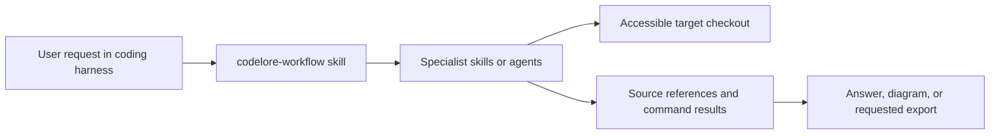

# How the project fits together

Codelore is a portable skill and agent suite installed by the Node CLI. The suite performs analysis in the active coding session.

## Skill and agent roles

The 11 canonical skills live under [`.agents/skills`](../.agents/skills), and 11 Codex agent definitions live under [`.codex/agents`](../.codex/agents). [Generated adapters](harness-support.md) expose the same agents to Claude Code, Cursor, Gemini CLI, GitHub Copilot, OpenCode, and Kiro. [`codelore-workflow`](../.agents/skills/codelore-workflow/SKILL.md) coordinates a complete review. Specialists handle repository intake, file exploration, architecture, execution tracing, dependency auditing, health, onboarding, codebase Q&A, revision refresh, and visual reports. The [feature coverage table](../.agents/skills/codelore-workflow/references/feature-coverage.md) maps each skill to its agent and expected output.

The coordinator establishes one target and revision, sends that scope to specialists, reconciles overlapping findings, and returns a cited synthesis. The agent definitions point to the same skill instructions; a host that cannot delegate agents can run the specialist skills sequentially in one session. The suite does not install a server, persist an analysis database, or create an app-specific JSON format by default.

## Evidence and boundaries

The [shared evidence contract](../.agents/skills/codelore-workflow/references/evidence.md) requires the revision, scope, method, source references, and coverage limits. Findings distinguish observed behavior from inference and unknowns. The [health rubric](../.agents/skills/codelore-health-insights/references/scoring.md) defines when a numerical score has enough evidence; otherwise the review remains unscored. A requested export or visualization is generated from evidenced results.

Repository access comes from the active coding session. A private checkout must already be accessible; the suite supplies no GitHub OAuth app. Model choice and data handling come from the host. Refresh compares specified revisions; ongoing monitoring requires separately configured scheduling and delivery.
